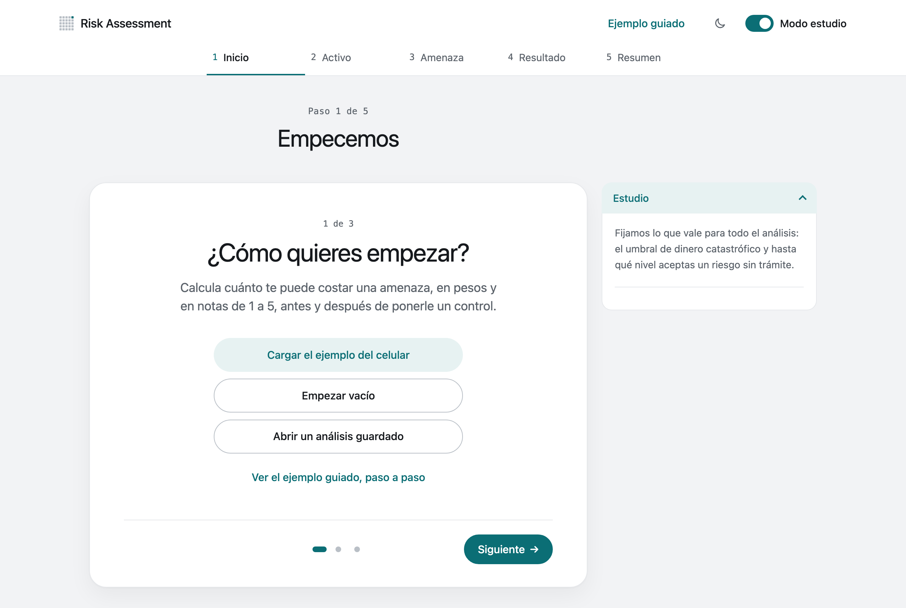

# Risk Assessment

Una herramienta web para **aprender análisis de riesgos haciéndolo**: eliges un activo, agregas una amenaza y un control, y ves cuánto riesgo hay antes y después, en pesos y en notas de 1 a 5. Al final decides qué haces con cada riesgo: mitigarlo, transferirlo, aceptarlo o evitarlo.



## Por qué existe

Es una **herramienta interactiva de estudio**. Mientras estudiaba gestión de riesgos quise ver la materia funcionando en vivo, no solo en fórmulas sueltas: qué pasa con el ALE si un control baja el factor de exposición, por qué un riesgo puede bajar en pesos y no en notas, cuándo un control cuesta más de lo que ahorra.

Se basa en el método que vimos en clase, inspirado en [MAGERIT](https://administracionelectronica.gob.es/documentacion/metodologias-guias/pae-magerit), convertido en algo que se puede tocar. Por eso existe el **modo estudio**: muestra cada cálculo con sus números, explica las siglas y avisa de los errores típicos.

## Qué hace

- **Cinco pasos**, una idea por tarjeta: inicio, activo, amenaza y control, resultado y resumen.
- **En pesos**: cuánto cuesta cada incidente (SLE), cuánto se pierde al año (ALE), cuánto ahorra el control y si ese ahorro paga lo que cuesta (valor neto).
- **En notas de 1 a 5**: la probabilidad, según cuántas veces al año pasa (ARO), y el impacto, que mira cuatro cosas: confidencialidad, integridad, disponibilidad y dinero. La disponibilidad se mide contra cuánto tiempo puedes estar sin el activo (MTD).
- **Tratamiento del riesgo**: el programa sugiere y explica por qué; la persona decide. Aceptar un riesgo por encima del umbral pide un formulario corto de excepción, con plan, fecha límite y revisión cada 3 meses.
- **Resumen**: la lista ordenada de riesgos, una matriz de calor, los controles con su valor neto y las excepciones aceptadas.
- **Modo estudio**: fórmulas con los números puestos, tablas de referencia y errores comunes, en un apéndice al lado de cada tarjeta.
- **Ejemplo guiado**: un celular (rotura, robo y seguro) resuelto paso a paso, con una pregunta antes de cada respuesta.
- Tema claro y oscuro, uso con teclado y lector de pantalla, y diseño adaptado a celular.

## Usarlo

- **En línea:** entra a [fabianubv.github.io/risk-assessment](https://fabianubv.github.io/risk-assessment/).
- **En tu computador:** descarga el repositorio y haz doble clic en `index.html`. No necesita instalar nada ni conexión a internet.

El análisis se guarda solo en tu navegador. Para llevarlo a otro lado, usa *Guardar* en el resumen: descarga un archivo `.json` que puedes volver a abrir después.

## Cómo está hecho

HTML, CSS y JavaScript sin frameworks, sin dependencias y sin paso de compilación. Usa scripts clásicos (no módulos) para que la página abra con doble clic.

Lo desarrollé con Claude (IA de Anthropic) como asistente de programación: yo definí qué debía hacer y las reglas de cálculo, tomé las decisiones de diseño y revisé los resultados contra los casos de clase.

| Archivo | Qué contiene |
|---|---|
| `index.html` | La página. |
| `src/logica.js` | El cálculo, separado de la pantalla. Usa **fracciones exactas** (`BigInt`) y solo redondea al mostrar, así un 0,3 nunca se confunde con 1/3 al decidir una nota. |
| `src/estado.js` | El análisis en memoria, el guardado local y la lectura y escritura de archivos. |
| `src/vistas.js`, `src/app.js` | Las pantallas (funciones que devuelven HTML) y los eventos. |
| `src/textos.js`, `src/guia.js` | Los textos del modo estudio y del ejemplo guiado, separados del código. |
| `src/ejemplo.js`, `src/catalogos.js` | El ejemplo del celular y las listas de activos, amenazas y orígenes. |
| `styles/` | Colores (claro y oscuro) y estilos. |
| `tests/`, `tools/verificar_casos.py` | Pruebas automáticas y una verificación independiente en Python. |
| `docs/` | El problema, el algoritmo y el tratamiento del riesgo, con sus decisiones. |

### Documentos

Antes de programar, el método se escribió en tres documentos. Ahí están las fórmulas, las reglas y los ejemplos resueltos a mano que después se usaron para probar la app.

| Documento | De qué trata |
|---|---|
| [El problema](docs/01-problema.md) | Qué datos pide la app, qué resultados entrega y con qué reglas. |
| [El algoritmo](docs/02-algoritmo.md) | El cálculo paso a paso y qué hacer en los casos raros (por ejemplo, una amenaza sin control). |
| [El tratamiento](docs/03-tratamiento.md) | Qué hacer con cada riesgo una vez calculado: mitigarlo, transferirlo, aceptarlo o evitarlo. |

Cuando la materia no decía qué hacer en algún caso, el documento explica qué se eligió y por qué.

### Pruebas

Los casos T1 a T20 de los documentos se verifican dos veces: con las pruebas de JavaScript (Node 18 o superior) y con un script en Python que usa `fractions`.

```bash
node --test
```

```bash
python3 tools/verificar_casos.py
```

## Privacidad y seguridad

- **Nada sale de tu navegador.** No hay servidor, cuentas, cookies ni seguimiento, y la app no se conecta a ningún otro sitio. Además, la página tiene una regla de seguridad (una *Content Security Policy*) que le prohíbe conectarse a internet o ejecutar código que no sea el suyo.
- **Lo que escribes se trata como texto, nunca como código.** Si en el nombre de un activo alguien escribe algo que parece código de una página web, la app lo muestra tal cual, como letras, y no lo ejecuta.
- **Los archivos guardados se revisan antes de abrirlos.** Si alguien modifica un `.json` a mano, la app lo rechaza o lo corrige, en vez de ejecutar lo que traiga o quedar trabada.
- Los datos del ejemplo son ficticios.

## Límites

- Es una herramienta para aprender, **no reemplaza una auditoría profesional**. Está inspirada en MAGERIT, pero no es una implementación certificada del método.
- Una amenaza tiene un solo control a la vez.
- Los montos son en pesos chilenos, sin decimales.

## Licencia

[MIT](LICENSE)
